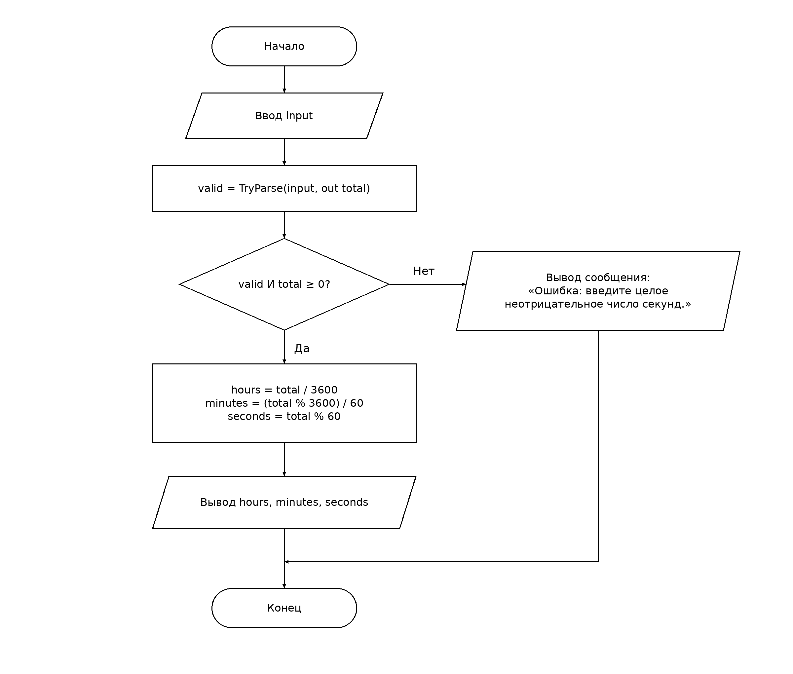

# Перевод секунд в часы, минуты и секунды

Автор: Муталип Азамат, группа ИС25-27б.

## 1. Словесная запись алгоритма

1. Начать выполнение программы.
2. Считать строку `input` с клавиатуры.
3. Попытаться преобразовать строку в целое число `total` с помощью `BigInteger.TryParse`; сохранить признак успеха в `valid`.
4. Проверить условие: преобразование успешно И `total >= 0`.
5. Если условие истинно, вычислить `hours = total / 3600`, `minutes = (total % 3600) / 60`, `seconds = total % 60` и вывести часы, минуты и секунды.
6. Иначе вывести: «Ошибка: введите целое неотрицательное число секунд.»
7. Завершить программу.

## 2. Псевдокод

```text
НАЧАЛО
    ВВОД input
    valid ← TryParseBigInteger(input, total)
    ЕСЛИ valid И total >= 0 ТО
        hours ← total DIV 3600
        minutes ← (total MOD 3600) DIV 60
        seconds ← total MOD 60
        ВЫВОД hours, " ч ", minutes, " мин ", seconds, " с"
    ИНАЧЕ
        ВЫВОД "Ошибка: введите целое неотрицательное число секунд."
    КОНЕЦ ЕСЛИ
КОНЕЦ
```

`DIV` — целочисленное деление, `MOD` — остаток от деления. В C# им соответствуют `/` и `%`. Часы не ограничены 23: переводится длительность, а не время суток. Тип `BigInteger` позволяет не ограничивать ввод диапазоном `int` или `long`.

## 3. Схема алгоритма



Редактируемый исходник: [scheme.drawio](scheme.drawio). Откройте его через «Файл → Открыть» в draw.io / diagrams.net. В PNG также встроен исходник схемы.

Использованы обозначения ГОСТ 19.701-90: терминаторы для начала и конца, параллелограммы для ввода и вывода, прямоугольники для обработки и ромб для решения. Выходы решения подписаны «Да» и «Нет».

Источник стандарта: https://protect.gost.ru/gost/details/0c85e066-f89e-433d-a6d3-b7f746bd0c7c

## 4. Консольная программа

Файлы: `Program.cs`, `srsp.csproj`. Порядок ввода, проверки, вычислений и вывода соответствует схеме. При ошибке выводится сообщение, затем программа завершается без повторного ввода.

Запуск из корня репозитория при установленном .NET SDK 8 или новее:

```bash
dotnet run --project t01/srsp/srsp.csproj
```

После запуска введите число секунд и нажмите Enter.

## 5. Проверка

| Ввод | Часы | Минуты | Секунды | Ожидаемый вывод |
| --- | ---: | ---: | ---: | --- |
| 3725 | 1 | 2 | 5 | `1 ч 2 мин 5 с` |
| 59 | 0 | 0 | 59 | `0 ч 0 мин 59 с` |
| 86399 | 23 | 59 | 59 | `23 ч 59 мин 59 с` |
| 0 | 0 | 0 | 0 | `0 ч 0 мин 0 с` |

Дополнительные случаи: `abc`, `-1`, `1.5` и пустая строка должны выдавать сообщение об ошибке. `86400` должно давать `24 ч 0 мин 0 с`.

Результаты основной таблицы проверены расчётом: `hours * 3600 + minutes * 60 + seconds = total`, минуты и секунды находятся в диапазоне 0–59. Запуск C# в среде подготовки не выполнен: .NET SDK отсутствует. Для проверки исполняемой программы выполните команду выше с каждым вводом.
