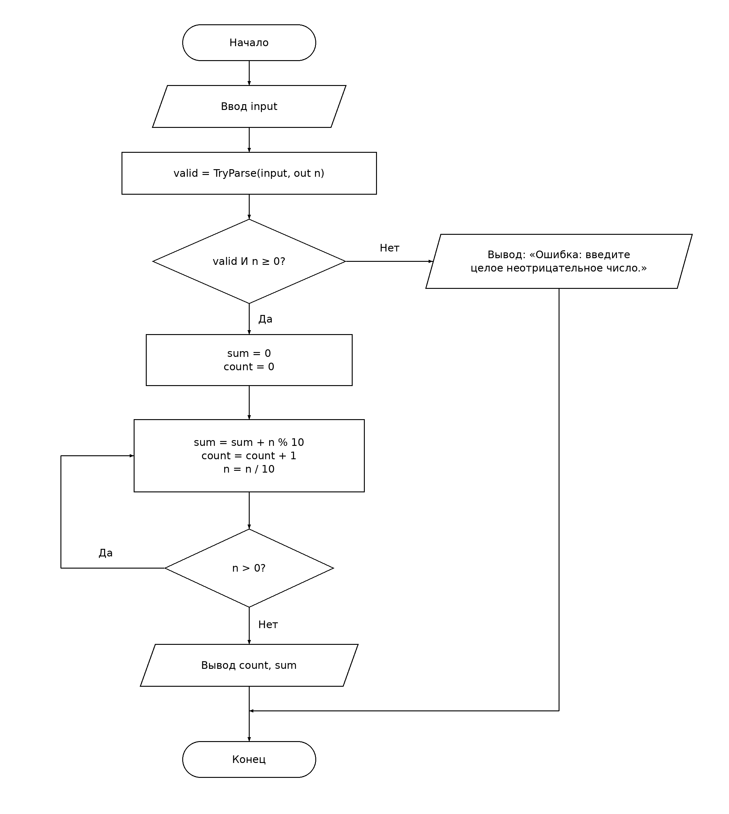

# СРСП 2. Количество и сумма цифр числа

Муталип Азамат, ИС25-27б.

## 1. Псевдокод

```text
НАЧАЛО
    ВВОД input
    valid ← TryParseBigInteger(input, n)
    ЕСЛИ valid И n >= 0 ТО
        sum ← 0
        count ← 0
        ДЕЛАТЬ
            sum ← sum + (n MOD 10)
            count ← count + 1
            n ← n DIV 10
        ПОКА n > 0
        ВЫВОД count, sum
    ИНАЧЕ
        ВЫВОД "Ошибка: введите целое неотрицательное число."
    КОНЕЦ ЕСЛИ
КОНЕЦ
```

`MOD` — остаток от деления (`%` в C#), `DIV` — целочисленное деление (`/` для целых типов в C#).

**У числа 0 одна цифра, сумма цифр равна 0.** Используется цикл с постусловием `do…while`: его тело выполняется хотя бы один раз. Цикл `while (n > 0)` без отдельной обработки нуля пропустил бы тело и ошибочно оставил количество равным 0.

На каждой итерации берём последнюю цифру `n % 10`, прибавляем её к сумме и удаляем целочисленным делением на 10. Переменная `n` изменяется; исходное число после цикла не требуется. Числа с ведущими нулями рассматриваются как целые: `0007` — это число 7 с одной цифрой.

## 2. Схема алгоритма



[Редактируемая схема draw.io](scheme.drawio). PNG также содержит встроенный XML схемы.

Обозначения ГОСТ 19.701-90: терминатор — начало/конец, параллелограмм — ввод/вывод, прямоугольник — обработка, ромб — решение. Обратная ветвь «Да» у условия `n > 0` возвращает управление к телу цикла, ветвь «Нет» ведёт к выводу.

Стандарт: https://protect.gost.ru/gost/details/0c85e066-f89e-433d-a6d3-b7f746bd0c7c

## 3. Ручная трассировка

В строке 0 указано состояние после инициализации. В остальных строках — состояние после выполнения тела соответствующей итерации, перед проверкой `n > 0`. В цикле с постусловием перед первой итерацией условие не проверяется.

### n = 472

| Итерация | n | Сумма (sum) | Количество (count) | Условие цикла n > 0 |
| --- | ---: | ---: | ---: | --- |
| 0 (инициализация) | 472 | 0 | 0 | Не проверяется |
| 1 | 47 | 2 | 1 | Истина — повторить |
| 2 | 4 | 9 | 2 | Истина — повторить |
| 3 | 0 | 13 | 3 | Ложь — завершить |

Обработка цифр: 2, затем 7, затем 4. Результат: 3 цифры, сумма 13.

### n = 0

| Итерация | n | Сумма (sum) | Количество (count) | Условие цикла n > 0 |
| --- | ---: | ---: | ---: | --- |
| 0 (инициализация) | 0 | 0 | 0 | Не проверяется |
| 1 | 0 | 0 | 1 | Ложь — завершить |

Результат: 1 цифра, сумма 0.

## 4. Программа C#

Файлы `Program.cs` и `srsp.csproj`. Порядок операций и обе проверки соответствуют схеме. Для целых используется `BigInteger`, чтобы не ограничивать ввод диапазоном `int` или `long`. `TryParse` обрабатывает нечисловой ввод без исключения; отрицательное число отклоняется отдельным условием в той же проверке.

Запуск из корня репозитория с .NET SDK 8 или новее:

```bash
dotnet run --project t02/srsp/srsp.csproj
```

Введите число и нажмите Enter. При ошибке программа выводит сообщение и завершается.

## 5. Проверка

| Ввод | Количество цифр | Сумма цифр | Ожидаемый вывод |
| --- | ---: | ---: | --- |
| 472 | 3 | 13 | `Количество цифр: 3; сумма цифр: 13` |
| 0 | 1 | 0 | `Количество цифр: 1; сумма цифр: 0` |
| 7 | 1 | 7 | `Количество цифр: 1; сумма цифр: 7` |
| 1000 | 4 | 1 | `Количество цифр: 4; сумма цифр: 1` |

Для `abc`, `-1`, `1.5` и пустой строки ожидается: `Ошибка: введите целое неотрицательное число.`

Расчёты и цикл проверены вспомогательным скриптом на Python для четырёх заданных вводов и всех чисел от 0 до 10000: результаты совпали с независимым подсчётом по десятичной записи. C# здесь не запускался, поскольку .NET SDK в среде подготовки отсутствует.
