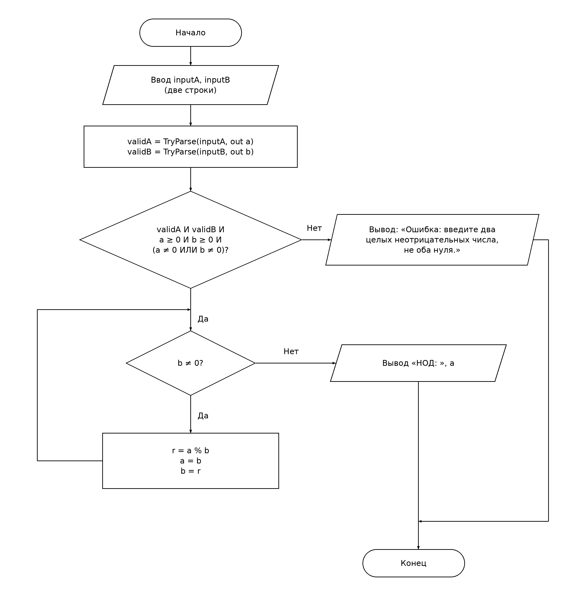

# СРСП 3. Алгоритм Евклида

Муталип Азамат, ИС25-27б.

## Условие и ввод

Найти НОД двух целых неотрицательных чисел a и b, которые не равны нулю одновременно. Программа считывает **две строки**: сначала a, затем b. Пример ввода:

```text
48
18
```

Используется BigInteger: большие целые не ограничены диапазоном int или long.

## 1. Схема алгоритма



[Исходник draw.io](scheme.drawio). PNG содержит встроенный XML схемы.

Обозначения ГОСТ 19.701-90: терминаторы для начала и конца; параллелограммы для ввода и вывода; прямоугольники для обработки; ромбы для решений. У каждого ромба подписаны выходы «Да» и «Нет».

Источник: https://protect.gost.ru/gost/details/0c85e066-f89e-433d-a6d3-b7f746bd0c7c

### Псевдокод по схеме

```text
НАЧАЛО
    ВВОД inputA, inputB (по одной строке)
    validA ← TryParseBigInteger(inputA, a)
    validB ← TryParseBigInteger(inputB, b)
    ЕСЛИ validA И validB И a >= 0 И b >= 0 И (a ≠ 0 ИЛИ b ≠ 0) ТО
        ПОКА b ≠ 0
            r ← a MOD b
            a ← b
            b ← r
        КОНЕЦ ПОКА
        ВЫВОД "НОД: ", a
    ИНАЧЕ
        ВЫВОД "Ошибка: введите два целых неотрицательных числа, не оба нуля."
    КОНЕЦ ЕСЛИ
КОНЕЦ
```

Деление по модулю выполняется только внутри цикла после проверки b ≠ 0, поэтому деления на ноль нет. При b = 0 и a > 0 цикл не выполняется, результат равен a. При a = 0 и b > 0 выполняется одна итерация, результат равен исходному b.

## 2. Таблица тестов (ожидаемые результаты до запуска)

Эта таблица и `tests.json` составлены и сохранены **до первого запуска программы**. Фактический прогон записывается отдельно в `test-results.md`; скрипт не изменяет ожидаемые результаты.

| Тест | a (первая строка) | b (вторая строка) | Ожидаемый вывод | Назначение |
| --- | --- | --- | --- | --- |
| T01 | `48` | `18` | `НОД: 6` | Обычный случай; 3 итерации |
| T02 | `25` | `0` | `НОД: 25` | Ноль итераций; выход «Нет» из b ≠ 0 сразу |
| T03 | `0` | `18` | `НОД: 18` | Нулевое a, ненулевое b; 1 итерация |
| T04 | `18` | `48` | `НОД: 6` | a < b; 4 итерации |
| T05 | `7` | `7` | `НОД: 7` | Равные числа; 1 итерация |
| T06 | `35` | `12` | `НОД: 1` | Взаимно простые числа; 3 итерации |
| T07 | `abc` | `18` | `Ошибка: введите два целых неотрицательных числа, не оба нуля.` | Нечисловое a |
| T08 | `48` | `abc` | `Ошибка: введите два целых неотрицательных числа, не оба нуля.` | Нечисловое b |
| T09 | `-48` | `18` | `Ошибка: введите два целых неотрицательных числа, не оба нуля.` | Отрицательное a |
| T10 | `48` | `-18` | `Ошибка: введите два целых неотрицательных числа, не оба нуля.` | Отрицательное b |
| T11 | `0` | `0` | `Ошибка: введите два целых неотрицательных числа, не оба нуля.` | Оба числа нулевые |
| T12 | `` | `18` | `Ошибка: введите два целых неотрицательных числа, не оба нуля.` | Пустая строка a |
| T13 | `48` | `` | `Ошибка: введите два целых неотрицательных числа, не оба нуля.` | Пустая строка b |
| T14 | `1.5` | `18` | `Ошибка: введите два целых неотрицательных числа, не оба нуля.` | Дробное a |
| T15 | `48` | `2.5` | `Ошибка: введите два целых неотрицательных числа, не оба нуля.` | Дробное b |
| T16 | `123456789012345678901234567890` | `0` | `НОД: 123456789012345678901234567890` | Большое целое; ноль итераций |

`Пустая строка` в тестах T12 и T13 обозначена пустыми обратными кавычками.

### Покрытие решений

| Решение на схеме | Выход «Да» | Выход «Нет» |
| --- | --- | --- |
| Корректный ввод и допустимые a, b? | T01–T06, T16 | T07–T15 |
| b ≠ 0? | T01, T03–T06 | T02, T16 сразу; T01, T03–T06 при завершении |

Покрыты оба выхода каждого решения. T02 и T16 проверяют ноль итераций. Некорректный ввод проверен для каждого аргумента, отрицательных значений, пустых строк, дробных значений и запрещённой пары (0, 0).

## 3. Ручная трассировка при a = 48, b = 18

Строка 0 — состояние до цикла. Остальные строки — после выполнения тела соответствующей итерации. Условие в последнем столбце проверяется для следующего входа в тело.

| Итерация | Вычисление r | a | b | r | b ≠ 0? |
| --- | --- | ---: | ---: | ---: | --- |
| 0 | Ещё не вычислялось | 48 | 18 | — | 18 ≠ 0 — да |
| 1 | 48 mod 18 = 12 | 18 | 12 | 12 | 12 ≠ 0 — да |
| 2 | 18 mod 12 = 6 | 12 | 6 | 6 | 6 ≠ 0 — да |
| 3 | 12 mod 6 = 0 | 6 | 0 | 0 | 0 ≠ 0 — нет |

Строки ввода inputA = "48", inputB = "18" и признаки validA = true, validB = true не изменяются в цикле. В программе r существует только внутри тела итерации; таблица показывает его последнее вычисленное значение.

**Результат:** НОД(48, 18) = 6. Вывод: `НОД: 6`.

## 4. Проект C# и прогон

Проект: `t03/Gcd/Gcd.csproj`, код: `t03/Gcd/Program.cs`.

Запуск из корня репозитория (.NET SDK 8 или новее):

```bash
dotnet run --project t03/Gcd/Gcd.csproj
```

Прогон всех тестов (нужны .NET SDK и Python 3):

```bash
python3 t03/srsp/run_tests.py
```

Скрипт собирает проект, запускает отдельный процесс для каждого теста и сравнивает весь вывод с заранее записанным ожидаемым результатом. Также проверяет код завершения. Отчёт сохраняется в `t03/srsp/test-results.md`.
