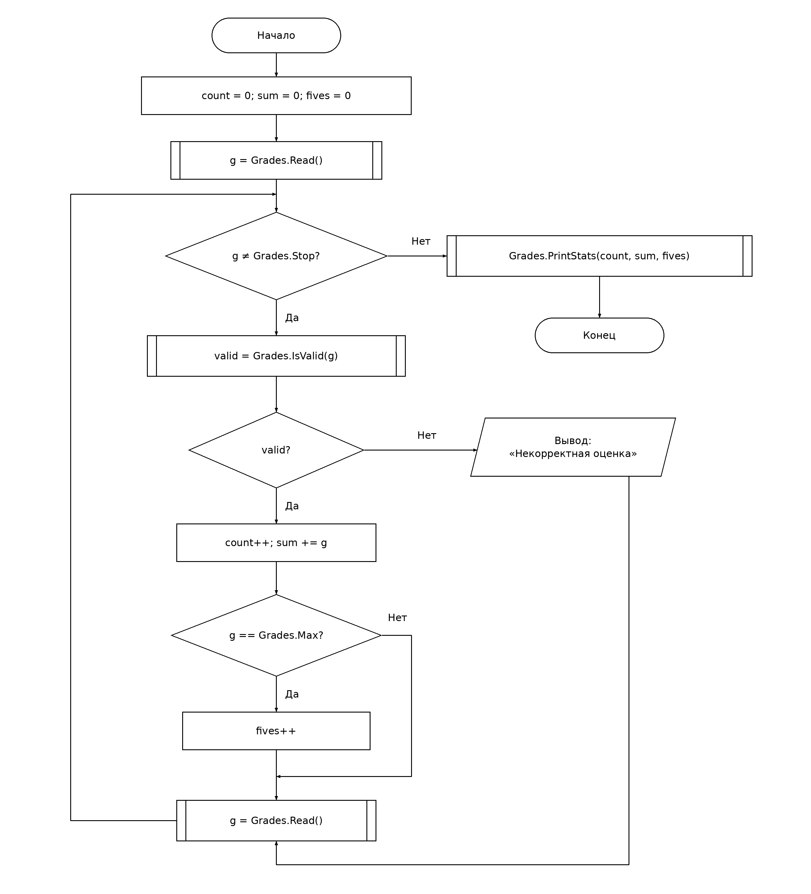

# СРСП 4. Статистика оценок: методы

## Структура

- `GradesStats/Program.cs` — инструкции верхнего уровня, затем `static class Grades`.
- `GradesStats/GradesStats.csproj` — консольный проект .NET 8.
- `scheme.drawio` и `scheme.png` — схема верхнего уровня.
- `tests.json` — входы и ожидаемый вывод, записанные до запуска.
- `test-results.md` — фактический вывод после запуска C#.

## Методы и константы

`Grades.Read()` читает одну строку, преобразует её в int и возвращает -1 при нечисловом вводе (включая значение вне диапазона int). `Grades.IsValid(int g)` возвращает true для оценок от Min до Max включительно. `Grades.PrintStats(int count, int sum, int fives)` выводит количество, сумму, средний балл и число пятёрок либо «Оценок нет».

Константы `Min = 2`, `Max = 5`, `Stop = 0` находятся в классе Grades и используются вместо границ оценок, значения пятёрки и признака остановки. Нули и единицы в инициализации и счётчиках имеют другой смысл. Средний балл вычисляется с дробной частью и выводится с двумя знаками после точки независимо от настроек языка.

После некорректного ввода выводится «Некорректная оценка»; статистика не изменяется. Затем читается следующее значение. Ввод завершается строкой 0. Как и в задании, для прогона требуется завершающий 0.

## Схема верхнего уровня



Все вызовы Read, IsValid и PrintStats показаны символом «предопределённый процесс» — прямоугольником с дополнительными вертикальными линиями. Результат IsValid сохраняется в переменной valid и проверяется ромбом, как в коде C#. Тела методов не разворачиваются в схеме верхнего уровня.

Остальные обозначения ГОСТ 19.701-90: терминатор, процесс, решение и данные. Обе ветви каждого решения подписаны.

## Проверки

| Тест | Ввод (каждое значение с новой строки) | Количество | Сумма | Средний балл | Пятёрок | Сообщения об ошибке |
| --- | --- | ---: | ---: | --- | ---: | ---: |
| T01 | 5, 4, 5, 0 | 3 | 14 | 4.67 | 2 | 0 |
| T02 | 0 | 0 | 0 | Не вычисляется; «Оценок нет» | 0 | 0 |
| T03 | 3, 7, abc, 2, 0 | 2 | 5 | 2.50 | 0 | 2 |

Точные ожидаемые строки находятся в tests.json, фактические — в test-results.md.

## Запуск

Из корня репозитория:

```bash
dotnet run --project t04/srsp/GradesStats/GradesStats.csproj
```

## Сравнение с практической работой 3

Исходная программа «Статистика оценок» и схема Б практической работы 3 не предоставлены и отсутствуют в репозитории на момент подготовки. Реализация соответствует перечисленным требованиям, все три заданных ввода проверены. **Побайтовое совпадение вывода с исходной программой не подтверждено:** для этого требуется её код или точный образец вывода. Текущие подписи и формат среднего балла выбраны явно и зафиксированы в тестах.
